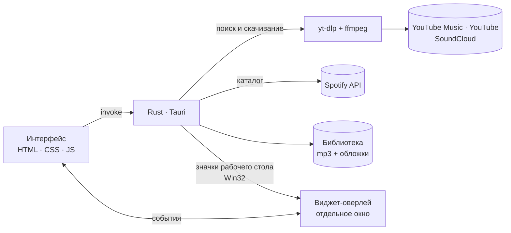

<div align="center">


<br>

[](https://github.com/BlackCapone/luma/releases/latest)
[](https://github.com/BlackCapone/luma/releases)


**Ищите треки на YouTube Music, SoundCloud, YouTube и в каталоге Spotify, слушайте их и оставляйте виджет на рабочем столе.**
Интерфейс подстраивается под цвета обложки, а в полноэкранном режиме обложка светится в её цветах.

[**⬇ Скачать**](https://github.com/BlackCapone/luma/releases/latest) · [Возможности](#-возможности) · [Установка](#-установка) · [Сборка](#-сборка-из-исходников)

</div>

---

## ✨ Возможности

<table>
<tr>
<td width="50%" valign="top">

### 🔎 Поиск по нескольким сервисам
YouTube Music, YouTube, SoundCloud и каталог Spotify. Можно искать сразу везде или выбрать один источник. Клик по треку скачивает его в mp3 вместе с обложкой и включает. Скачанное остаётся в библиотеке и играет без интернета.

</td>
<td width="50%" valign="top">

### 🎨 Цвет из обложки
Подсветка, кнопки и фон меняются под текущий трек и плавно перетекают от одного цвета к другому.

</td>
</tr>
<tr>
<td width="50%" valign="top">

### 〰️ Волна трека
Вместо обычного ползунка волна из 160 столбиков. Кликайте и тяните, чтобы перематывать.

</td>
<td width="50%" valign="top">

### 🌌 Режим «Сейчас играет»
Полноэкранный режим с большой обложкой. Свечение идёт от каждого края отдельно: если снизу обложка синяя, а сверху белая, вниз пойдёт синий свет, вверх белый.

</td>
</tr>
<tr>
<td width="50%" valign="top">

### 🪟 Виджет на рабочем столе
Стеклянная карточка с обложкой, прогрессом, громкостью и управлением. Лежит над рабочим столом, но под вашими окнами, и не мешает работе.

</td>
<td width="50%" valign="top">

### 🧲 Выбор места с сеткой
Экран затемняется, главное окно сворачивается, виджет можно перетащить по сетке. Ярлыки на рабочем столе подсвечиваются красным, и на них поставить виджет нельзя.

</td>
</tr>
</table>

## 📦 Установка

Откройте [страницу релизов](https://github.com/BlackCapone/luma/releases/latest) и выберите файл.

| Файл | Когда брать |
|---|---|
| **`Luma-portable-win64.zip`** | Рекомендуется. Распакуйте и запустите `Luma.exe`. `yt-dlp` и `ffmpeg` уже лежат рядом. |
| **`Luma-Setup.exe`** | Обычный установщик. Дополнительно поставьте `yt-dlp` и `ffmpeg` и добавьте их в `PATH`, например `winget install yt-dlp.yt-dlp Gyan.FFmpeg`. |

> **Требования:** Windows 10/11 и WebView2. На Windows 11 он уже установлен, для Windows 10 [скачайте его у Microsoft](https://developer.microsoft.com/microsoft-edge/webview2/).

## 🚀 Как пользоваться

1. Введите название трека или исполнителя, выберите источник под строкой поиска и нажмите **Enter**.
2. Кликните по карточке: трек скачается и сразу заиграет.
3. Кликните по обложке или названию внизу, чтобы открыть **«Сейчас играет»**. Закрыть можно клавишей **Esc**.
4. Включите виджет: **Настройки → Виджет на рабочем столе → Показывать виджет на рабочем столе**.
5. Нажмите **«Выбрать место»**, перетащите виджет и нажмите **«Готово»**.

Чтобы удалить трек, наведите на него и дважды нажмите на корзину. Всю библиотеку можно очистить в **Настройки → Библиотека**. Кнопки перемешивания и повтора (выкл, все треки, один трек) есть внизу и в режиме «Сейчас играет».

Пробел ставит на паузу. Скачанные треки лежат в `%APPDATA%\com.luma.player\tracks`.

## 🎧 Источники

| Источник | Как работает |
|---|---|
| **YouTube Music** | поиск по песням, скачивание через `yt-dlp` |
| **YouTube** | обычный поиск по видео |
| **SoundCloud** | поиск и скачивание через `yt-dlp` |
| **Spotify** | аудио Spotify защищено, поэтому Luma берёт из Spotify только каталог (до 10 результатов), а сам трек находит и скачивает на YouTube Music. Нужны ключи приложения с [developer.spotify.com/dashboard](https://developer.spotify.com/dashboard): **Настройки → Spotify**. |

## ⚙️ Настройки

Всё включается и выключается на вкладке **«Настройки»** и сохраняется между запусками.

| Группа | Что можно менять |
|---|---|
| **Оформление** | список или плитки, цвета из обложки, цветная подсветка шапки, анимации, метка «Скачан», волна вместо полосы прогресса |
| **Поиск** | какие источники входят во вкладку «Все», число результатов, ключи Spotify |
| **Приложение** | пробел как пауза, полный экран окна в «Сейчас играет», свечение обложки и его сила |
| **Виджет** | показ на рабочем столе, только пока играет музыка, уровень (над рабочим столом или поверх всех окон), обложка, прогресс и время, громкость, размер, прозрачность, сетка с привязкой, запрет на ярлыки, сворачивание окна при выборе места |

## 🧩 Как это устроено



Интерфейс написан на чистых HTML, CSS и JS без сборщика. Rust отвечает за поиск, скачивание и список значков рабочего стола. Виджет это второе прозрачное окно, оно общается с главным через события Tauri.

```
luma/
├─ src/
│  ├─ index.html        главное окно: поиск, библиотека, настройки, «Сейчас играет»
│  └─ overlay.html      виджет и режим выбора места
├─ src-tauri/
│  ├─ src/main.rs       команды: search, download, library, desktop_icons
│  ├─ tauri.conf.json   окна и права
│  └─ capabilities/     разрешения окон
├─ assets/              баннер для README
└─ .github/workflows/   сборка и публикация релиза
```

## 🛠 Сборка из исходников

Нужны [Rust](https://rustup.rs), Node.js (для CLI) и WebView2.

```bash
git clone https://github.com/BlackCapone/luma.git
cd luma

# запуск в режиме разработки
npx @tauri-apps/cli@2 dev

# сборка exe и установщика
npx @tauri-apps/cli@2 build
```

Для работы нужны `yt-dlp.exe` и `ffmpeg.exe`: положите их рядом с `luma.exe` или добавьте в `PATH`.

Релиз собирается автоматически: достаточно отправить тег вида `v0.1.0`, и GitHub Actions соберёт установщик и портативный архив.

## ⚠️ Важно

Luma скачивает треки через `yt-dlp` только для личного прослушивания. Уважайте права авторов и условия использования SoundCloud, не распространяйте скачанное. Проект не связан с SoundCloud.

## 🙏 Благодарности

[Tauri](https://tauri.app) · [yt-dlp](https://github.com/yt-dlp/yt-dlp) · [FFmpeg](https://ffmpeg.org) (портативная сборка использует [сборки BtbN](https://github.com/BtbN/FFmpeg-Builds))
